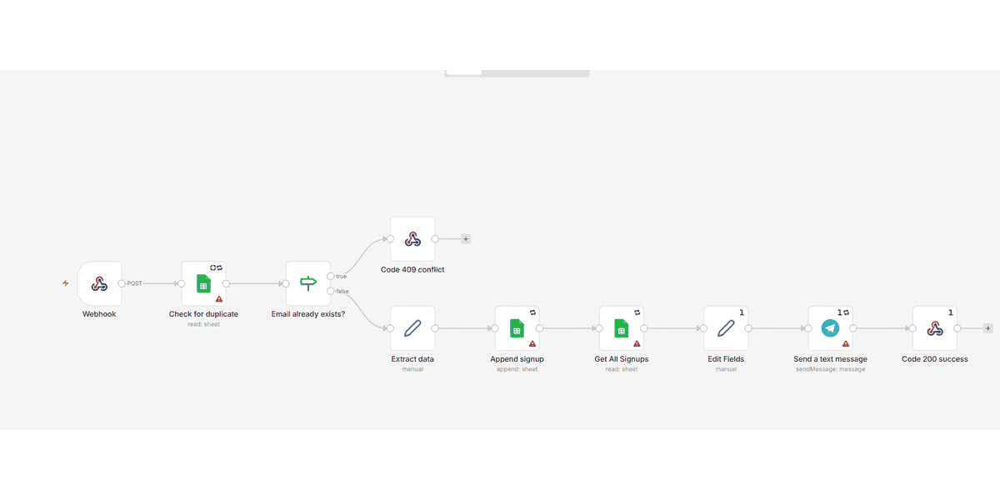
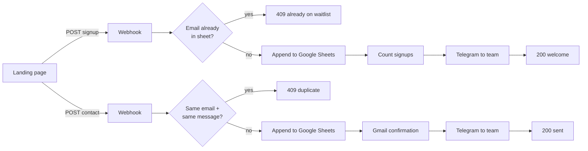
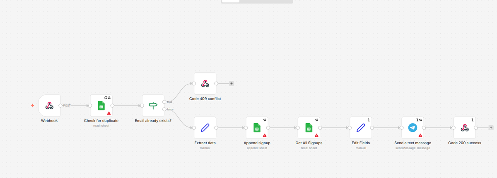
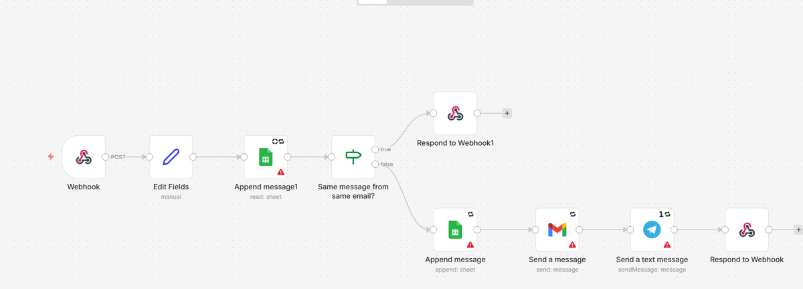

# Website form automations: waitlist signup and contact form (n8n)

Two n8n workflows behind the buttons of the landing page I built for PawPath, the dog accessories company we created in an entrepreneurship minor: one handles **waitlist signups**, the other the **contact form**. Both receive the form as a webhook, block duplicates, store the data in Google Sheets, send a Telegram notification and answer the website with a proper HTTP status and message.

> The two workflows in n8n. To run them you need your own Google Sheets, Gmail and Telegram credentials (see "How to run it").

## The problem

In my entrepreneurship minor we had to create a company. We chose dog accessories and called it PawPath. It had a landing page, which ran on its own domain during the minor, with a waitlist where people choose a plan, and a contact form. Both forms post to n8n webhooks: the data lands in a spreadsheet, duplicates are rejected with a clear message, and every new signup or message shows up in a Telegram chat right away. Through the site we collected 25 emails on the waitlist.

## What it does

**Waitlist signup** (`workflows/waitlist-signup.workflow.json`)
1. `POST /pawpath/signup` with `email` and the chosen `plan`
2. looks the email up in the "Emails_Collected" sheet; if it is already there, answers **409** ("you are already on our waitlist")
3. otherwise appends email, plan and date, counts all signups and sends the team a Telegram message ("A new person has signed up! Total: N emails collected.")
4. answers **200** with a welcome message

**Contact form** (`workflows/contact-form.workflow.json`)
1. `POST /pawpath/contact` with `email` and `message`
2. if the same email already sent the same message, answers **409** ("You have already submitted this message.")
3. otherwise stores email, message and date in the "Messages_Received" sheet, sends the visitor an HTML confirmation email through Gmail ("we reply within 24 hours"), posts the first 150 characters of the message to the team's Telegram chat
4. answers **200**

Both webhooks only accept calls from the website's origin (CORS `allowedOrigins`) and use "respond to webhook" nodes, so the page can show a different message for success and for duplicates.

## Architecture

| Waitlist signup | Contact form |
|---|---|
|  |  |

## Tech stack

n8n (Webhook, If, Set, Google Sheets, Gmail, Telegram, Respond to Webhook), Google Sheets as the data store, HTML email template.

## How to run it

1. Import both files from `workflows/` into n8n (Workflows > Import from file). Works on n8n 2.4.7.
2. Create credentials and select them in the nodes: Google Sheets (OAuth), Gmail (OAuth), Telegram bot.
3. Create a spreadsheet with the tabs `Emails_Collected` (Email, Subscription, Date) and `Messages_Received` (Email, Message, Date) and select it where you see `<LONG_ID_…>`.
4. Put your Telegram chat ID in the Telegram nodes (`<PHONE_1>` placeholder), your site's origin in `allowedOrigins` (`<URL_1>`) and your links in the email template and Telegram texts (`<URL_…>`).
5. Activate the workflows and point your form's `fetch` calls at the two webhook URLs.

### Placeholders

Credentials and webhook IDs are not in this repo. The spreadsheet ID, the Telegram chat ID, URLs and emails are replaced by placeholders such as `<URL_1>`; the same value always gets the same placeholder.

## My contribution

In the minor I built the landing page and these two automations. The website itself is not part of this repository.

**About this repository:** the workflows are mine. I exported and packaged them for GitHub (this README, screenshots, removing private data) with help from an AI assistant, which is why the commits list Claude as co-author.

## Status and limitations

- Used on the landing page during the minor (25 waitlist signups).
- Duplicate checks read the whole sheet through the Sheets API; fine for a waitlist, slow for large volumes, and two identical requests at the same moment can both pass the check.
- The webhooks have CORS but no rate limiting or captcha, so a script could still flood the sheet.
- The signup count is computed by reading every row on each signup.

## What I would change for production

- A real database with a unique constraint on the email instead of "read then append".
- A captcha or rate limit in front of the webhooks.
- Double opt-in (confirmation link) for the waitlist, and a privacy notice for the stored emails.
- An error branch that alerts the team when Google or Telegram calls fail.
